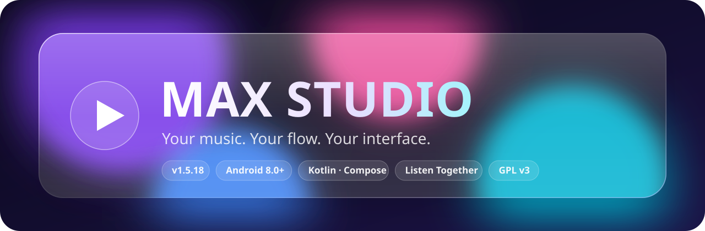
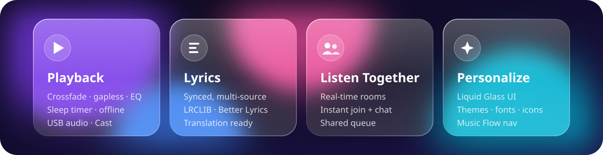
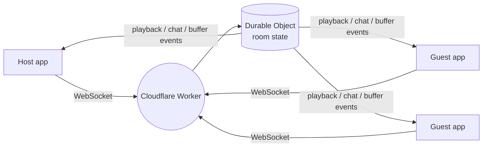

<div align="center">



<a href="https://github.com/kryvexo/MAX-STUDIO-/releases/latest">
  
</a>

<br/>

<a href="https://github.com/kryvexo/MAX-STUDIO-/releases/latest"></a>

<br/><br/>

[](https://github.com/kryvexo/MAX-STUDIO-/releases/latest)
[](https://github.com/kryvexo/MAX-STUDIO-/releases)
[](https://github.com/kryvexo/MAX-STUDIO-/stargazers)
[](https://github.com/kryvexo/MAX-STUDIO-/network/members)

[](https://github.com/kryvexo/MAX-STUDIO-/actions/workflows/android-build.yml)
[](https://github.com/kryvexo/MAX-STUDIO-/commits/main)
[](https://github.com/kryvexo/MAX-STUDIO-/issues)
[](https://github.com/kryvexo/MAX-STUDIO-)
[](LICENSE)


<sub>**[Website](https://kryvexo.github.io/MAX-STUDIO-/)** &nbsp;·&nbsp; **[Releases](https://github.com/kryvexo/MAX-STUDIO-/releases)** &nbsp;·&nbsp; **[Report a bug](https://github.com/kryvexo/MAX-STUDIO-/issues/new)** &nbsp;·&nbsp; **[Privacy policy](PRIVACY_POLICY.md)**</sub>

</div>


## Contents

[Overview](#overview) · [Screenshots](#screenshots) · [Features](#features) · [Listen Together](#listen-together) · [Install](#download-and-install) · [Build](#build-from-source) · [Structure](#project-structure) · [Tech stack](#tech-stack) · [FAQ](#faq) · [Privacy](#privacy-and-third-party-services) · [Contributing](#contributing) · [Security](#security) · [Credits](#acknowledgements) · [License](#license-and-disclaimer)


## Overview

**MAX STUDIO** is an open-source Android music app built around flexible listening and deep personalization. Explore music, play local tracks, follow synchronized lyrics, listen together with friends in real time, and shape the interface to your own style.



| Quick facts | |
|:--|:--|
| Version | `1.5.18` (versionCode `189`) |
| Package | `com.max.music` |
| Minimum Android | 8.0 · API 26 |
| Target / compile SDK | 36 / 37 |
| Stack | Kotlin · Jetpack Compose · Material 3 · Media3 |
| Variants | `foss` and `gms`, universal and per-ABI |
| License | GNU GPL v3.0 |


## Screenshots

<p align="center">
  <a href="https://github.com/kryvexo/MAX-STUDIO-/blob/main/SCREENSHOTS/Screenshot_2026-10-25-08-50-42-859_com.max.music.jpg"></a>
  &nbsp;&nbsp;
  <a href="https://github.com/kryvexo/MAX-STUDIO-/blob/main/SCREENSHOTS/Screenshot_2026-10-25-08-51-13-101_com.max.music.jpg"></a>
  &nbsp;&nbsp;
  <a href="https://github.com/kryvexo/MAX-STUDIO-/blob/main/SCREENSHOTS/Screenshot_2026-10-25-08-51-18-838_com.max.music.jpg"></a>
</p>
<p align="center"><sub>Home and Music Flow · About · Update settings</sub></p>

<p align="center">
  <a href="https://github.com/kryvexo/MAX-STUDIO-/blob/main/SCREENSHOTS/Screenshot_2026-10-25-08-50-59-825_com.max.music.jpg"></a>
</p>
<p align="center"><sub>Landscape playback with synchronized lyrics</sub></p>

> Images load from the repository's `SCREENSHOTS` folder on `main`. Replace a file there and it updates here. Some captures may show an older app version.


## Features

<table>
<tr>
<td width="50%" valign="top">

### Playback
- Background playback and full queue controls
- Crossfade and gapless playback
- Skip silence, tempo and pitch
- Equalizer and audio normalization
- Sleep timer
- Local music and offline downloads
- USB audio output
- Google Cast (GMS build)
- Home-screen widgets

</td>
<td width="50%" valign="top">

### Lyrics
- Synchronized lyrics with several display styles
- Multiple sources, including LRCLIB, Better Lyrics, KuGou, SimpMusic and Unison
- Optional translation-provider integrations

### Discovery and services
- Browse and discover music
- **Echo Find** music recognition
- Last.fm and ListenBrainz scrobbling
- Spotify import
- Discord Rich Presence
- Canvas (looping visuals)

</td>
</tr>
<tr>
<td width="50%" valign="top">

### Personalization
- Material 3 with **Liquid Glass** effects and ambient mode
- Multiple player layouts and themes
- Custom fonts and launcher icons
- **Music Flow** navigation with a compact floating bar
- Haptics settings and blocked artists
- Backup and restore, storage management
- Many interface languages

</td>
<td width="50%" valign="top">

### Social
- **Listen Together** rooms with instant join
- Shared queue and live chat
- Host controls: guest playback permission, kick, hand over host
- Invite by code, link or QR code

</td>
</tr>
</table>

> Some features need a network connection, an account or an API key. Third-party service behavior and availability can change independently of MAX STUDIO.


## Listen Together

Create a room, share the code or link, and everyone hears the same track in sync.

| Capability | How it works |
|:--|:--|
| Rooms | The host creates a room. Friends join with a code, link or QR code |
| Instant join | Join requests are approved automatically for the host |
| Sync | Play, pause, seek, track changes and queue updates mirror across devices |
| Buffer sync | Guests report when a track is ready, so playback starts together |
| Chat | Live room chat for everyone in the room |
| Controls | The host can allow guests to control playback, remove users or hand over host |
| Reconnect | A dropped user can rejoin the room within a grace period |



The backend runs on **Cloudflare Workers** with a **Durable Object** that keeps room state in memory. The same Worker serves share and invite links, the Android App Links verification file and the canvas list. You can change the server in **Settings → Integrations → Listen Together**.


## Download and install

1. Open [GitHub Releases](https://github.com/kryvexo/MAX-STUDIO-/releases/latest).
2. Download the latest Android APK.
3. Open the APK and follow Android's install prompts. You may need to allow your browser or file manager to install apps.

> **Updating:** Android only updates an installed app when the new APK has the same package ID and the same signing certificate. If Android refuses an update because the signing key differs, back up your data (Settings → Backup and restore) before uninstalling the old version.


## Build from source

**Requirements:** Android Studio or the Android SDK command-line tools, JDK 21, Android SDK Platform 37 with matching build tools, and Git.

```bash
git clone https://github.com/kryvexo/MAX-STUDIO-.git
cd MAX-STUDIO-
cp local.properties.template local.properties
```

Set your SDK path in `local.properties`:

```properties
sdk.dir=/path/to/your/Android/Sdk
```

On Windows use `gradlew.bat` instead of `./gradlew`.

### Build variants

| Flavor | Notes |
|:--|:--|
| `foss` | Leaves out features that depend on Google Play Services, such as Cast |
| `gms` | Includes Google-dependent integrations |
| `universal`, `arm64`, `armeabi`, `x86`, `x86_64` | ABI variants |

```bash
# Universal FOSS debug APK
./gradlew assembleUniversalFossDebug

# Universal GMS debug APK
./gradlew assembleUniversalGmsDebug

# Unit tests
./gradlew :app:testUniversalFossDebugUnitTest
```

APKs are written to `app/build/outputs/apk/`.

### Release signing

A release APK needs **your own** signing key. Keep the keystore and passwords private and **never commit them**.

```bash
export KEYSTORE_PATH=/path/to/release-key.jks
export KEY_ALIAS=your_key_alias
export STORE_PASSWORD=your_store_password
export KEY_PASSWORD=your_key_password
./gradlew assembleUniversalGmsRelease
```

**GitHub Actions:** add the repository secrets `KEYSTORE_BASE64`, `KEY_ALIAS`, `STORE_PASSWORD` and `KEY_PASSWORD`. With `KEYSTORE_BASE64` present, the workflow builds a signed release APK. Without it, it builds a debug APK.

Always sign every release with the **same keystore**, otherwise users cannot update in place.


## Project structure

| Module | Purpose |
|:--|:--|
| `app` | Android application: UI, navigation, settings, Listen Together client |
| `core`, `domain` | Shared data layer, database entities and domain models |
| `playback` | Playback engine and service integration |
| `innertube`, `metadata` | Music catalog and metadata access |
| `lyrics`, `lrclib`, `betterlyrics`, `kugou`, `simpmusic`, `unison`, `paxsenixlyrics`, `youlyplus` | Lyrics engine and individual providers |
| `canvas`, `echomusiccanvas`, `applecanvas`, `artistvideo` | Canvas and artist visuals |
| `shazamkit` | Music recognition (Echo Find) |
| `audio-dsp`, `dsp-core`, `usbaudio` | Audio processing and USB audio output |

More: [`SETUP.md`](SETUP.md) · [`DESIGN.md`](DESIGN.md) · [`CONTRIBUTING.md`](CONTRIBUTING.md) · [`RELEASE_INFO.md`](RELEASE_INFO.md)

## Tech stack

| Area | Technology |
|:--|:--|
| Language | Kotlin 2.3 |
| UI | Jetpack Compose 1.10 · Material 3 |
| Media | AndroidX Media3 (ExoPlayer) |
| Data | Room · Kotlin Serialization |
| Dependency injection | Hilt |
| Networking | Ktor · OkHttp (WebSocket for Listen Together) |
| Images | Coil |
| Backend | Cloudflare Workers · Durable Objects |
| CI/CD | GitHub Actions |


## FAQ

<details>
<summary><b>The update fails with "App not installed". Why?</b></summary>
<br/>
The new APK is signed with a different key than the installed app. Back up your data, uninstall the old app, then install the new APK.
</details>

<details>
<summary><b>Do I need a Google account?</b></summary>
<br/>
No. Many features work without signing in. Some features, such as account-based content, need a login.
</details>

<details>
<summary><b>How do I use Listen Together?</b></summary>
<br/>
Open Listen Together, create a room and share the code, link or QR code. Friends join instantly and the host's playback stays in sync for the whole room.
</details>

<details>
<summary><b>Which build should I pick, FOSS or GMS?</b></summary>
<br/>
Pick <code>gms</code> if you want Google Cast and other Google-dependent features. Pick <code>foss</code> if you prefer a build without Google Play Services dependencies.
</details>

<details>
<summary><b>Does MAX STUDIO host music?</b></summary>
<br/>
No. It does not host music or video files. See the disclaimer below.
</details>

## Privacy and third-party services

Read [`PRIVACY_POLICY.md`](PRIVACY_POLICY.md) for the project's stated data practices. MAX STUDIO may connect to third-party services you choose to use. The download counter in the About page requests public release metadata from GitHub. It counts total downloads, not unique or active users, and GitHub receives ordinary request metadata such as the device's IP address.

Listen Together sends room messages (playback state, track info and chat) through the server you select.

## Contributing

Contributions are welcome.

1. Search [existing issues](https://github.com/kryvexo/MAX-STUDIO-/issues) first.
2. Fork the repository and create a feature branch.
3. Follow [`CONTRIBUTING.md`](CONTRIBUTING.md) and the [Code of Conduct](CODE_OF_CONDUCT.md).
4. Open a pull request with a clear description.

<a href="https://github.com/kryvexo/MAX-STUDIO-/graphs/contributors"></a>

## Security

Found a vulnerability? Please do not open a public issue. Follow the steps in [`SECURITY.md`](SECURITY.md).

## Acknowledgements

MAX STUDIO acknowledges the open-source work of [Metrolist](https://github.com/MetrolistGroup/Metrolist), [Vivi Music](https://github.com/vivizzz007/vivi-music), [ArchiveTune](https://github.com/koiverse/ArchiveTune), [Better Lyrics](https://better-lyrics.boidu.dev/), [SimpMusic](https://github.com/maxrave-dev/SimpMusic), [Music Recognizer](https://github.com/aleksey-saenko/MusicRecognizer) and [BravePipe](https://github.com/bravepipeproject/BravePipe). Each project remains subject to its own license and notices.

## License and disclaimer

MAX STUDIO is distributed under the [GNU General Public License v3.0](LICENSE). Third-party components and assets may have separate licenses.

MAX STUDIO is an independent project and is not affiliated with YouTube, Google, Spotify, Apple or other third-party services. It does not host music or video files. Users are responsible for complying with applicable laws and third-party service terms.


<div align="center">


[](https://t.me/kryvexo)
[](https://instagram.com/maxgotiissues)
[](https://maxown.online)

<a href="https://star-history.com/#kryvexo/MAX-STUDIO-&Date"></a>

<sub>If you enjoy MAX STUDIO, consider giving the repository a star.</sub>

</div>
